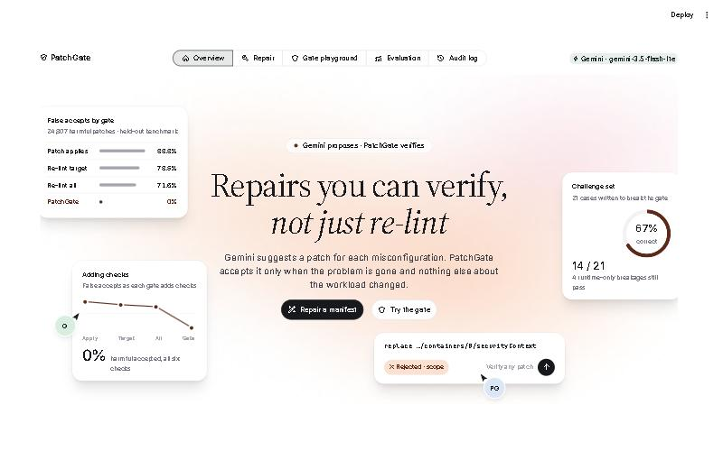
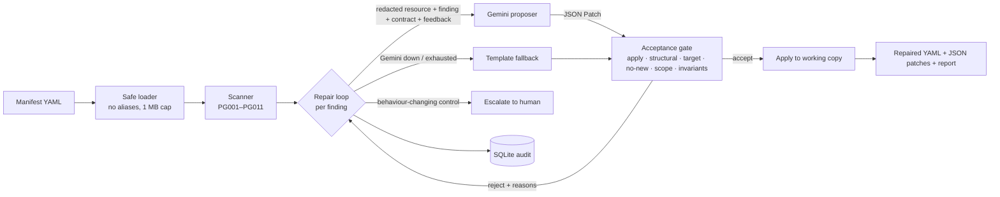

# PatchGate — verified, behaviour-preserving repair of Kubernetes misconfigurations

**Live demo:** https://patchgate.streamlit.app · works without an API key (simulated and template proposers)



**In one line:** Gemini proposes fixes for Kubernetes security misconfigurations. A deterministic gate accepts a
fix only if the problem is gone *and nothing else about the workload changed*. On a seeded benchmark, re-running
the linter let through 71.6% of harmful patches; PatchGate let through none. Limits and caveats are below.

Python · Google Gemini (google-genai) · Streamlit · FastAPI · pytest (120 offline tests)

## Abstract

Security linters such as kube-linter, Checkov and Kubescape flag Kubernetes manifests that run privileged
containers, allow privilege escalation, run as root, and so on. Automated fixes for these findings come
from templates (`kubescape fix`) or, increasingly, from LLMs (GenKubeSec, KubeGuard, coding assistants).
The usual check that such a fix is correct is to **re-run the linter**. That check is blind to collateral
damage: a patch that deletes the offending container, rewrites a selector, bumps the image, or replaces
a whole `securityContext` can pass re-linting while silently breaking the workload.

PatchGate puts Gemini behind a deterministic **acceptance gate**. Gemini proposes a JSON Patch for a
single finding. The patch is accepted only if it (1) applies, (2) introduces no new API-schema or type
errors, (3) resolves the targeted finding, (4) introduces no new findings, (5) only touches the paths in
that control's **repair contract**, and (6) preserves the workload's **behavioural invariants**: identity,
selectors and labels, images, commands, ports, env, existing volumes and mounts, existing resource
values, plus semantic constraints such as limits ≥ requests and probes targeting declared ports.
Rejections go back to Gemini as concrete counterexamples, within a bounded number of attempts. If
Gemini fails or is unavailable, PatchGate falls back to template fixes, which go through the same gate.
Fixes that change behaviour (replacing `hostPath`, choosing an image version) are escalated to a human.

On a seeded benchmark of 30,386 labelled candidate patches (seed 2026), the re-lint baseline
accepted 71.6% of harmful candidates and PatchGate accepted none. Both rejected 0% of valid candidates.
This benchmark's taxonomy was written by the same author as the gate (see *Limitations*). On an
independent hand-written challenge set, PatchGate still accepted 4/13 harmful patches (all runtime-only
breakage) and rejected 3/8 legitimate ones; re-linting accepted 13/13 harmful patches.

## Problem statement

Given a Kubernetes manifest and a misconfiguration finding, produce a minimal patch that removes the
finding **without changing what the workload does**, and refuse (escalate) when that cannot be shown.

## Objectives

1. Detect 11 Pod Security Standards / reliability misconfigurations deterministically.
2. Use Gemini to propose repairs, including ones templates handle poorly (e.g. adding `emptyDir` mounts
   for a read-only root filesystem).
3. Accept a patch only after machine-checkable verification; feed rejections back to Gemini.
4. Measure how much the gate improves on the re-lint baseline, with ablations of each gate component.
5. Keep secrets away from the LLM, bound all API spending, and leave an audit trail.

## Features

| Feature | Where |
|---|---|
| 11 controls (PG001–PG011) with per-control repair contracts | `src/patchgate/checks.py` |
| Restricted RFC 6902 patch engine (no `move`/`copy`, atomic, ≤ 40 ops) and leaf-level diff | `src/patchgate/patch.py` |
| Six-stage acceptance gate with switchable components (baselines and ablations) | `src/patchgate/verifier.py` |
| Gemini proposer (google-genai SDK, JSON schema output, bounded retries, call budget, redaction) | `src/patchgate/llm.py` |
| Counterexample-guided repair loop with template fallback and human escalation | `src/patchgate/repair.py` |
| SQLite audit trail (stores manifest hash, never manifest contents) | `src/patchgate/store.py` |
| CLI (`scan`, `repair`, `verify`, `runs`, `check-config`) | `src/patchgate/cli.py` |
| FastAPI service (`/scan`, `/verify`, `/repair`, `/runs`) | `src/patchgate/api.py` |
| Streamlit UI incl. a *gate playground* comparing baselines vs PatchGate | `app/streamlit_app.py` |
| Seeded benchmark, hand-written challenge set, optional live-Gemini study | `evaluation/` |

## Technology stack

Python 3.12 · `google-genai` 2.33 (official Google GenAI SDK) · Pydantic 2 · PyYAML · FastAPI + Uvicorn ·
Streamlit · SQLite (stdlib `sqlite3`) · pytest. No Docker, cluster or vector database is needed: the core
problem is structural verification, not retrieval. The audit log has two tables, so it uses stdlib
`sqlite3` rather than an ORM.

## Architecture



Details: [docs/ARCHITECTURE.md](docs/ARCHITECTURE.md).

## Installation (Windows, PowerShell)

```bash
cd patchgate
```

```bash
python -m venv .venv
```

```bash
.\.venv\Scripts\Activate.ps1
```

```bash
python -m pip install -e ".[dev]"
```

If `Activate.ps1` is blocked by execution policy, run `Set-ExecutionPolicy -Scope Process RemoteSigned`
in that window, or call `.\.venv\Scripts\python.exe` directly.

## Configuration

```bash
copy .env.example .env
```

Edit `.env` and set `GEMINI_API_KEY` (create one at https://aistudio.google.com/apikey). `.env` is
git-ignored and the key is never logged. Check the setup:

```bash
patchgate check-config
```

```bash
patchgate check-config --live
```

`--live` makes exactly one real Gemini request.

| Variable | Default | Meaning |
|---|---|---|
| `GEMINI_API_KEY` (or `GOOGLE_API_KEY`) | – | Required only for the `gemini` proposer |
| `GEMINI_MODEL` | `gemini-2.5-flash` | Any model available to your key |
| `GEMINI_TIMEOUT_S` | 60 | Per-request timeout |
| `GEMINI_MAX_RETRIES` | 3 | Retries for 408/429/5xx/timeouts only |
| `PATCHGATE_MAX_LLM_CALLS` | 30 | Hard cap on requests per run (retries included) |
| `PATCHGATE_MAX_ATTEMPTS` | 3 | Proposals per finding |
| `PATCHGATE_DB` | `data/patchgate.db` | Audit database |
| `PATCHGATE_REDACT` | `true` | Mask env values, annotations, secret-like args before sending to Gemini |

## Running

There are three proposers:
- `gemini`: live model; needs a key.
- `template`: deterministic, like `kubescape fix`.
- `simulated`: replays **hand-written** example candidates, some deliberately wrong, to demo the gate offline. Clearly labelled; it is not Gemini output.

```bash
patchgate scan examples\web-app.yaml
```

```bash
patchgate repair examples\web-app.yaml --proposer simulated --out repaired.yaml --report report.json
```

```bash
patchgate repair examples\web-app.yaml --proposer gemini --out repaired.yaml
```

```bash
streamlit run app/streamlit_app.py --server.address localhost
```

```bash
uvicorn patchgate.api:app --host 127.0.0.1 --port 8000
```

Verify a patch produced by any other tool (exit code 0 = accepted, 2 = rejected):

```bash
patchgate verify examples\web-app.yaml --resource 1 --control PG002 --subject web --patch my-patch.json --compare
```

The API has no authentication by design: it is a local developer tool. Bind it to `127.0.0.1` only.

## Testing

```bash
python -m pytest
```

121 tests: 120 run offline with Gemini mocked, including 5 headless UI tests (all pass); 1 live test runs only when `PATCHGATE_LIVE_KEY`
is set (`python -m pytest -m live`). It passed against `gemini-3.5-flash-lite`. Results: [docs/TESTING.md](docs/TESTING.md).

## Evaluation

```bash
python -m evaluation.run_eval --seed 2026 --workloads 300 --out evaluation/results --prefix test_seed2026
```

```bash
python -m evaluation.challenge_set
```

```bash
python -m evaluation.live_eval --findings 30 --attempts 3 --max-calls 120
```

```bash
python -m evaluation.merge_live
```

The first two need no network and finish in well under a minute. The third needs a key, and its spending
is capped by `--max-calls`. On the free tier, set `GEMINI_RPM=5` first. Free-tier daily quotas are small
(20 requests/day per model on the test key), so keep `--max-calls` under that.

Live Gemini results:
- On `web-app.yaml` (`gemini-2.5-flash`), 11 of 12 auto-repairable findings were repaired by Gemini alone,
  10 on the first attempt.
- In the live study (22 findings over two days, mostly `gemini-3.5-flash-lite`), 22/22 single-shot patches were
  accepted by PatchGate, and re-lint and PatchGate never disagreed.

Methodology and measured
numbers: [docs/EVALUATION.md](docs/EVALUATION.md).

## Demonstration (about 10 minutes)

1. `patchgate scan examples\web-app.yaml`: 13 findings. `PG009` (untagged image) is marked `[manual]`.
2. `patchgate repair examples\web-app.yaml --proposer simulated --out repaired.yaml`. Watch the gate
   reject, with the exact reason:
   - an over-broad `securityContext` rewrite (scope);
   - a string `"true"` (structural + target);
   - a collateral image bump (scope + invariants);
   - limits below requests (invariants);
   - a probe on undeclared port 8081 (invariants).

   Each time, the corrected candidate is accepted on the next attempt.
3. Open the UI → **Gate playground**. Paste
   `[{"op":"replace","path":"/spec/template/spec/containers/0/securityContext","value":{"allowPrivilegeEscalation":false}}]`
   for `PG002 [web]`. All three baseline gates **ACCEPT**; PatchGate **REJECTS** it because it deletes `runAsUser`
   (see `docs/screenshots/gate-playground.jpg`).
4. `patchgate repair examples\node-agent.yaml --proposer simulated`: `hostPath` (PG008) is escalated, not "fixed".
5. With a key: repeat step 2 using `--proposer gemini`. Inspect real proposals and rejections with `patchgate runs --id N`.
6. Run the two offline evaluation commands and open the **Evaluation** tab.

Reset: delete `data\patchgate.db` (audit log) and any `repaired.yaml` / `report.json` you created.

## Troubleshooting

| Symptom | Fix |
|---|---|
| `GEMINI_API_KEY is not set` | Copy `.env.example` to `.env`, set the key, run from the `patchgate` folder |
| `Gemini rejected the request (403/404)` | Key invalid or model not available to it: change `GEMINI_MODEL` |
| `Gemini unavailable after retries` | Rate limit/outage; the run degrades to template fixes and says so. On the free tier set `GEMINI_RPM=5` |
| `Gemini quota exhausted; server asks to retry in N h` | Daily free-tier quota used up: wait, switch `GEMINI_MODEL` (quotas are per model), or use a paid tier |
| `404 … no longer available to new users` | Use the model the message suggests, e.g. `GEMINI_MODEL=gemini-3.5-flash-lite` |
| `YAML aliases are not allowed` | Expand anchors (`&`/`*`) before scanning; refused to prevent alias bombs |
| `refusing to overwrite the input manifest` | Pass a different `--out` path |
| `patchgate` not found | Activate the venv, or use `.\.venv\Scripts\patchgate.exe` |

## Limitations

- **Static only.** The gate cannot see runtime behaviour. A read-only root filesystem for an app that writes
  `/var/run`, a UID the image cannot use, or a too-small memory limit all pass. These are reported as
  *runtime assumptions to validate*, and the challenge set measures this blind spot (4/13 false accepts).
- **Conservative scope.** Harmless extras such as adding `runAsGroup` or a liveness probe are rejected (3/8
  false rejects on the challenge set).
- **Benchmark circularity.** The mutation taxonomy and the gate share an author. 0% false accepts on it
  shows coverage of *that* taxonomy, not real-world LLM error rates. The live-Gemini study meant to address
  this covered 22 simple findings (the free tier allows 20 requests/day/model). In it, Gemini made no harmful
  edits that only PatchGate caught (0/22; 95% upper bound 13.6%). One real Gemini patch (nginx read-only
  root) was a runtime-only breakage that the gate cannot see. Harder cases and other proposers are untested.
- **Known gaps after a self-audit.** Three gate blind spots were found and closed: capability removal,
  mounts that hide image files, and pod-level side effects on other containers. Still open: the gate accepts
  probe timings that will flap, the scratch-mount allowlist is conservative, redaction is pattern-based, and
  the benchmark was re-run after these fixes, so it is no longer strictly held out
  ([docs/EVALUATION.md](docs/EVALUATION.md)).
- **Coverage.** 11 controls on pod templates only. No RBAC, NetworkPolicy, Helm or Kustomize rendering.
  Comments in YAML are not preserved in the repaired file; the emitted JSON patches can be applied instead.

## Future work

Server-side dry-run (`kubectl apply --dry-run=server`) as an extra gate stage when a cluster is
available. Runtime validation in `kind` for the runtime-assumption class. Helm/Kustomize rendering.
Learned scope extensions from accepted human overrides. A manual-labelling study of live Gemini output.

## Documentation

[Research](docs/RESEARCH.md) · [Architecture](docs/ARCHITECTURE.md) · [Testing](docs/TESTING.md) ·
[Evaluation](docs/EVALUATION.md) · [Report draft](docs/REPORT.md) · [Faculty Q&A](docs/FACULTY_QA.md)
