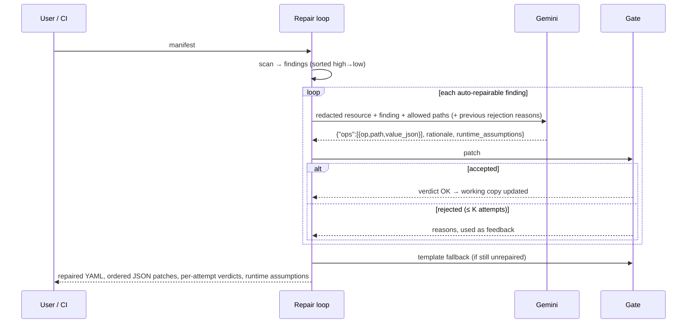
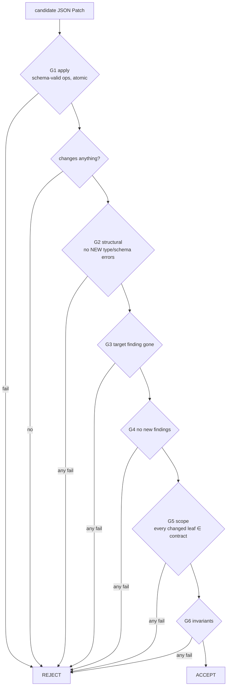

# Architecture

## Components

| Module | Responsibility | Depends on Gemini? |
|---|---|---|
| `manifest.py` | Safe multi-document YAML loading (no aliases, 1 MB / 200 docs cap, `List` expansion), JSON-pointer helpers, pod-spec location per workload kind | no |
| `checks.py` | 11 controls; each has detection logic **and a repair contract** (allowed path patterns, `auto_repairable`, runtime assumptions) | no |
| `patch.py` | Restricted RFC 6902 engine (`add`/`remove`/`replace`/`test`), atomic, ≤ 40 ops; leaf-level structural diff | no |
| `verifier.py` | The acceptance gate (G1–G6), quantity parser, structural validator, invariant checker; gate presets for baselines/ablations | no |
| `fixers.py` | Deterministic template fixes (fallback proposer and benchmark reference) | no |
| `llm.py` | Proposer interface; `GeminiProposer` (SDK client, schema-constrained JSON, retries, budget, redaction), `TemplateProposer`, `ScriptedProposer` (simulated) | `GeminiProposer` only |
| `repair.py` | Per-finding loop: propose → verify → feedback → accept/fallback/escalate | via proposer |
| `store.py` | SQLite audit log of runs and attempts | no |
| `cli.py`, `api.py`, `app/streamlit_app.py` | Interfaces | no |

The core (`checks`, `patch`, `verifier`, `fixers`) never imports the SDK. All gate behaviour is
deterministic and tested offline.

## Data flow

## The gate

All checks run, so a rejection lists **every** reason, which gives Gemini more useful feedback.

- **Scope (G5).** Each control lists patterns such as `{ctr}/securityContext/allowPrivilegeEscalation`.
  `{ctr}` expands to the specific container's pointer and `{pod}` to the pod spec; `*` matches one segment
  and a trailing `**` matches any suffix. Changed paths are computed at leaf level, so creating a missing
  `securityContext` object counts as touching only the leaves inside it.
- **Invariants (G6).** These are protected regardless of scope:
  - everything outside the pod spec (identity, labels, selector, replicas, schedule, strategy, serviceName);
  - pod-level non-security fields (serviceAccountName, restartPolicy, nodeSelector, …);
  - the container list and order;
  - per-container image, command/args, ports, env, envFrom, lifecycle, liveness and startup probes,
    and an existing readiness probe;
  - existing volumes and mounts (prefix-preserved);
  - existing resource values.

  Semantic constraints on the result: limits ≥ requests; new volumes are plain `emptyDir`; no newly added
  capabilities, and no removal of capabilities the container may keep (`NET_BIND_SERVICE`); new mounts only at
  scratch locations (`/tmp`, `/var/tmp`, `/run`, `/var/run`, `/var/cache`, `/var/log`) and never over an
  existing mount; a new readiness probe targets a declared port; `runAsUser` is never newly set to 0.

  Cross-container effects of pod-level edits: no container may end up both required to be non-root and set to
  UID 0 (the kubelet refuses to start it). A pod-level change may alter the effective `runAsNonRoot`,
  `runAsUser`, `runAsGroup` or `seccompProfile` of another container only if that container had the same
  finding.
- **Structural (G2).** A focused subset of Kubernetes API validation: known keys for `securityContext`,
  containers and probes; booleans and integers correctly typed; exactly one probe handler; exactly one source
  per volume; valid quantities; mounts that reference defined volumes. Only errors *introduced* by the patch
  count, so pre-existing quirks do not block repairs.

## Key design decisions

1. **The patch is the unit of trust, not the YAML.** Gemini returns JSON Patch rather than a rewritten
   manifest, so every change is enumerable and auditable, and the users' files never pass through the
   model's text generation.
2. **`value_json` strings in the response schema.** Gemini's response schema cannot express arbitrary JSON
   values cleanly, so each value travels as JSON text and is parsed and validated locally.
3. **Escalate behaviour-changing fixes.** `hostPath` replacement and image pinning have no
   behaviour-preserving fix, so they are marked `manual` instead of guessed.
4. **Redaction preserves structure.** Env values, annotation values and secret-like args are masked, but
   paths stay identical, so patches still apply to the original. Copying a placeholder back into the
   manifest is caught by the env invariant.
5. **No cluster required.** This keeps the tool laptop-friendly and CI-friendly. The cost is the
   runtime-blindness limitation.

## Failure handling

| Failure | Behaviour |
|---|---|
| Missing/placeholder API key | `ConfigError` with instructions; CLI exit 2; API 400; UI hides the Gemini option |
| 408/429/5xx/timeout | Exponential backoff with jitter (cap 20 s); at most `GEMINI_MAX_RETRIES`; each retry consumes budget |
| 400/401/403/404 | No retry; `LLMUnavailable` naming the key and model |
| Budget exhausted / Gemini unavailable | Run marked `degraded`; no more model calls; remaining findings use template fallback, still gated |
| Malformed model output | Becomes a failed attempt with the parse error as feedback |
| Patch fails to apply | Atomic: nothing changes; reason recorded |
| Invalid/oversized/alias-bomb YAML | `ManifestError` (exit 2 / HTTP 422) |
| Output path equals input | Refused |
| Audit write failure | Single transaction, rolled back; the error surfaces (no silent success) |
